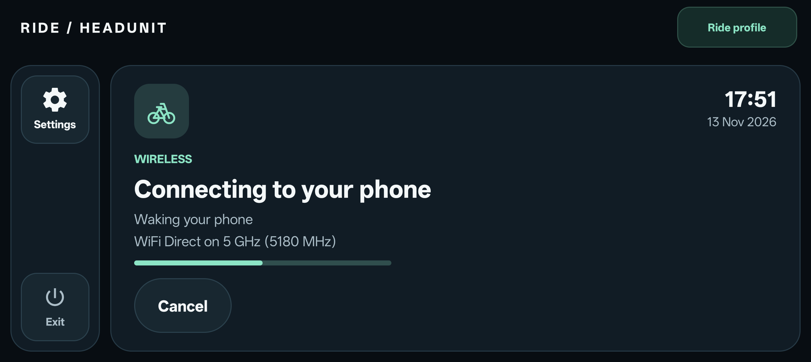

# Ride Headunit — Android Auto Receiver for Motorcycles

Turn an old Android phone into a wireless Android Auto display for your motorcycle. Ride Headunit is a bike-focused receiver for an Android phone or tablet, forked from [Open Headunit](https://github.com/andreknieriem/open-headunit). Your main phone supplies Android Auto; the receiver provides the display, touch input and wireless connection.

**[Download the preview APK](https://github.com/gaur-adi/ride-unit/releases/tag/v4.0.0-bike.4)** · **[Project website and setup guide](https://gaur-adi.github.io/ride-unit/)** · [Report an issue](https://github.com/gaur-adi/ride-unit/issues)

This independent fork was tested on a OnePlus 10T running Android 15. It is not an official Google, OnePlus or Open Headunit release.



## What changed

- Dark dashboard with large connection controls, a clock and a **Ride profile** selector.
- **Smooth:** hardware H.264, SurfaceView, 720p at 30 FPS, with optional low-latency codec configuration and the upstream fallback ladder.
- **Sharp:** 1080p at 30 FPS. **Compatibility:** 720p with TextureView and low-latency requests disabled.
- Decorative connection shimmer, widgets and favorites start disabled.
- Automatic portrait/landscape support. With system **Auto-rotate on**, the screen follows the phone. With it **off**, Auto mode defaults to landscape.
- A rotation held for 1.2 seconds reconnects Android Auto to negotiate the correct layout. Brief turns back do not restart the session.
- A separate application ID, `com.aditya.bikeheadunit`, so it can coexist with the upstream app.

## Requirements and setup

This fork builds an **ARM64-only APK for Android 6.0+**. The main phone must support Android Auto.

1. Download `Ride-Headunit-4.0.0-bike.4.apk` from the [preview release](https://github.com/gaur-adi/ride-unit/releases/tag/v4.0.0-bike.4), verify its SHA-256 checksum if desired, and install it on the receiver phone, finish the first-run notice, and grant the connection permissions.
2. Keep Bluetooth and Wi-Fi enabled on both phones.
3. Use **Native** wireless mode on the receiver and pair the main phone through Bluetooth. If the phone cached another receiver's services, forget and pair again while Ride Headunit is listening.
4. Accept the main phone's Android Auto setup prompts.

Native wireless mode does not require enabling Developer options, USB debugging or root on the main phone. Wireless compatibility still depends on Android Auto and the devices' Bluetooth/Wi-Fi implementations. Run only one receiver app at a time.

The normal Android launcher can remain the default. Dedicated Home/boot automation is optional and can be configured through the receiver's settings; it is not enabled automatically by this fork.

## Build

Use JDK 21, Android SDK 36, CMake 3.22.1 and NDK 29.0.14206865. Configure the Android SDK using `ANDROID_HOME` or a local `local.properties` file.

```sh
./gradlew :app:assembleGithubDebug
./gradlew :app:testGithubDebugUnitTest --tests '*Bike*Test'
```

The APK is written to `app/build/outputs/apk/github/debug/`. Debug builds use your local Android debug signing key. Keep the same signing identity for future APK updates; keys and device configuration are not included in this repository.

## Limitations and validation

Google supplies the projected Android Auto interface. This fork cannot redesign Google's Maps/Spotify screens or make Google Maps in Android Auto accept motorcycle routes. Google Maps currently requests driving directions when a two-wheeler route is selected on the main phone. Use motorcycle routing directly on a phone if you need that routing mode.

Nine bike-specific tests cover saved profile choices, fallback behavior, phone identity preservation, portrait/landscape dashboard layout, rotation transitions and the system rotation toggle. The custom build was installed on a OnePlus 10T, wireless projection was verified, and the user reported smooth operation after tuning. These observations are not a controlled performance benchmark. Calls, audio routing, heat, long rides and a full reboot cycle need device-specific testing.

See [implementation details](BIKE-EDITION.md), the [retained upstream README](docs/UPSTREAM_README.md), and [upstream setup documentation](https://github.com/andreknieriem/open-headunit/wiki).

## Attribution and license

Based on Open Headunit commit `5511654d0d01`, itself descended from Michael Reid's headunit project. Existing copyright notices, the [AGPL-3.0 license](LICENSE) and bundled license assets are retained. This repository provides the modified source; review the license before redistributing builds.

Final publication validation: the GitHub debug APK assembled successfully, and the full local unit suite passed (4,821 tests, zero failures or errors).
